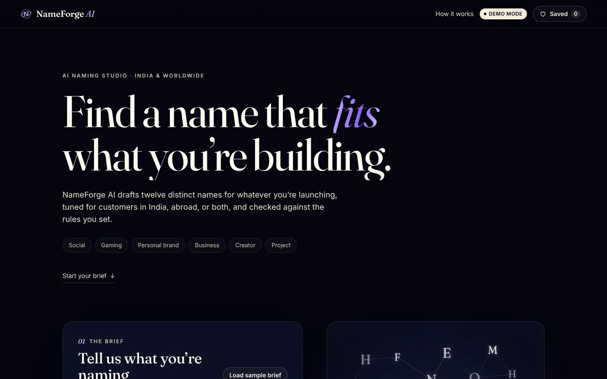
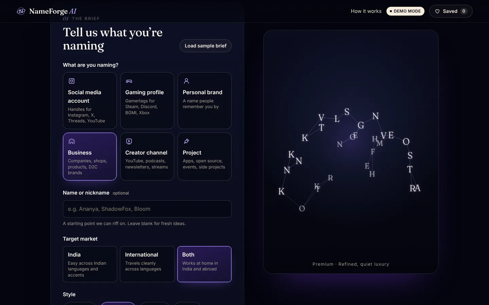
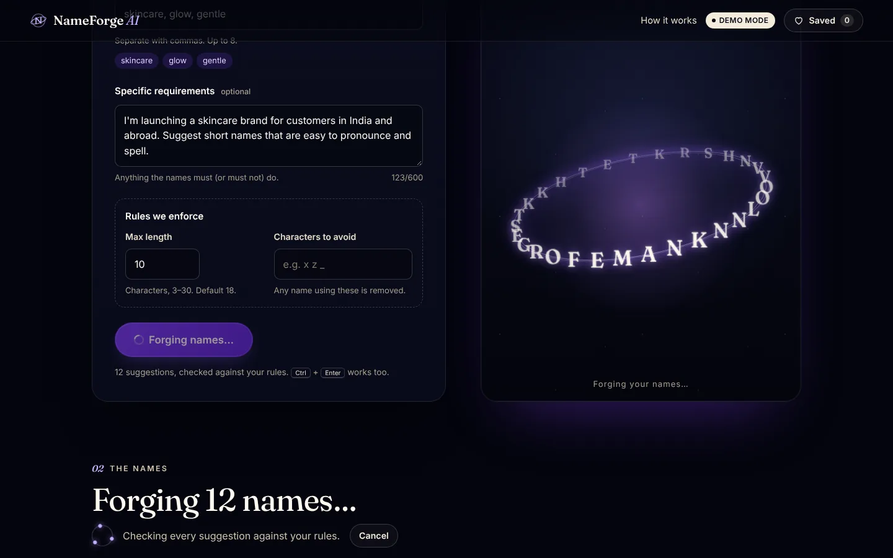
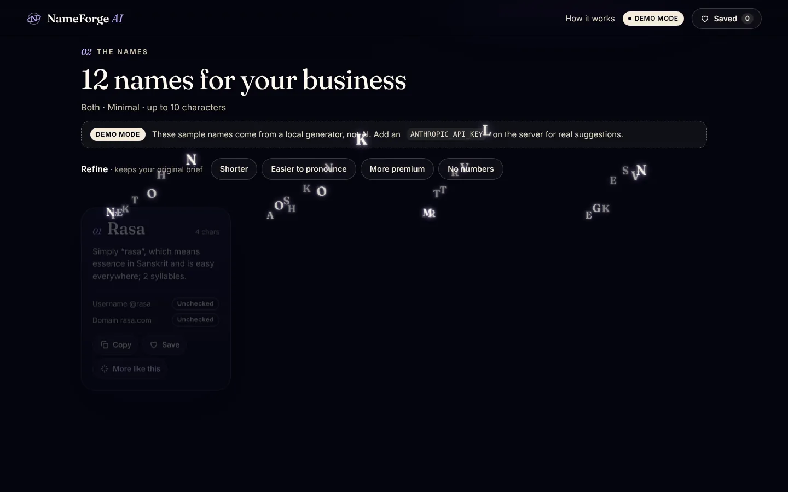
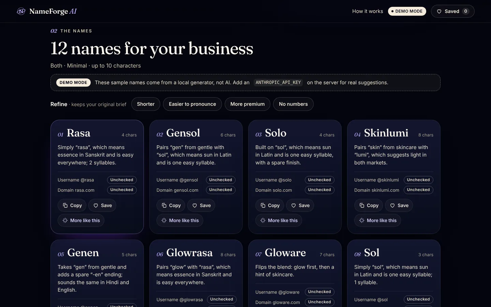
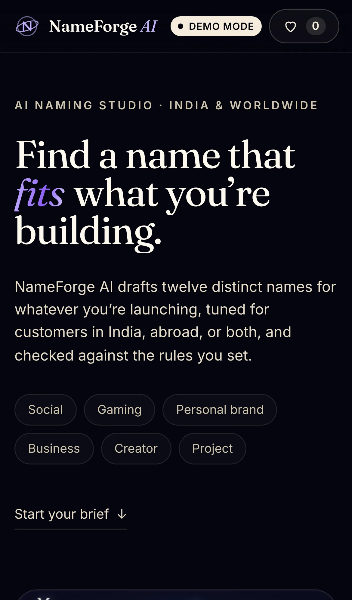
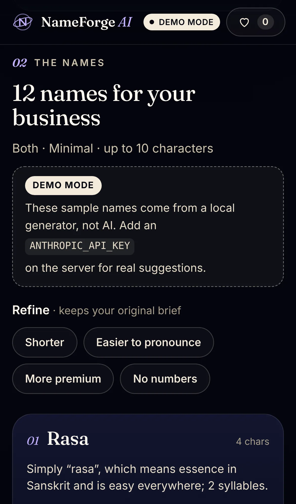
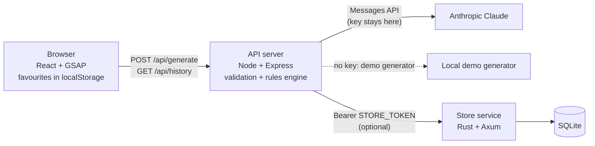

# NameForge AI

**Find a name that fits what you’re building.**

[](https://github.com/SumitDendage/name-history-/actions/workflows/ci.yml)

NameForge AI is a cinematic AI naming studio for clients in India and around the world. Describe what you're naming (a social account, gaming profile, personal brand, business, creator channel or project), pick a market and a style, and get **12 distinct names**, each with a one-line reason and checked against the rules you set.



| Pick a style: the letters rearrange | Generate: they gather into a glowing orbit |
| --- | --- |
|  |  |
| **Results arrive: the orbit unfolds into the cards** | **12 names, each with a reason** |
|  |  |

<p align="center">
  
  &nbsp;&nbsp;
  
</p>

## Features

- **Guided brief:** what you're naming, an optional name or nickname, target market (**India**, **International** or **Both**), style (modern, premium, playful, bold, minimal), keywords and free-text requirements. A **sample brief** loads in one click.
- **Rules that are actually enforced:** the server checks every suggestion for maximum length, allowed characters, characters you asked to avoid, numbers, duplicates and repeats. If too few names pass, it returns fewer than 12 and says why.
- **Refinements that keep your brief:** **Shorter**, **Easier to pronounce**, **More premium** and **No numbers** stack on top of the original brief and rules. **More like this** riffs on a name you like.
- **Favourites** are saved in the browser (localStorage) and sync across tabs.
- **Availability is honest:** every username and domain is labelled **Unchecked**.
- **Recent briefs** (optional): a small Rust + SQLite service remembers each browser's last briefs so they can be reloaded.
- **Demo mode:** runs without an AI key using a local sample generator. It's clearly labelled in the header and above the results.
- **Loading, empty, error and retry states**, a Cancel button, and an option to switch to demo mode if the AI is unavailable.
- **Cinematic motion with GSAP:** a slowly drifting constellation of letters beside the form. It rearranges when you choose a style, gathers into a glowing orbit while names generate, and unfolds into the first row of name cards as the page pans down.
- **Accessible:** keyboard navigation throughout (skip link, native radio groups, focus management, a focus-trapped dialog, Ctrl/Cmd + Enter to submit), live-region announcements, `prefers-reduced-motion` support, and a simplified animation on phones.

## Tech stack

| Layer | Choice | Why |
| --- | --- | --- |
| Frontend | **React 19 + Vite 8 + TypeScript**, **GSAP 3** | Fast dev server and builds. GSAP drives the constellation from one ticker with plain state objects, so dozens of letters and lines animate smoothly. |
| Fonts | Fraunces + Inter (self-hosted via Fontsource) | Editorial serif for the cinematic headlines, a clean UI sans. No third-party font requests. |
| API | **Node.js 20+ + Express 5 + Zod 4** | Small and well understood. Zod validates every brief and gives field-level errors. |
| AI | **Anthropic Claude** (`claude-opus-5-5` by default) via `@anthropic-ai/sdk` | Structured JSON output, configurable effort, and server-side refusal fallbacks. The key stays on the server. |
| Store | **Rust (Axum 0.8 + Tokio) + SQLite (rusqlite, bundled)** | A tiny, fast, single-binary service with an embedded database. No database server to run. |
| Tests | Vitest + Supertest, `cargo test`, Playwright (manual e2e) | Unit and HTTP tests for the rules engine, API and store. |
| Hosting | **Netlify** (static site + Netlify Functions), or any Node host | The same API handlers run in Express and in Netlify Functions. |
| CI | GitHub Actions | Typecheck, test and build the web app; fmt, clippy and test the store. |

## Architecture



1. The browser sends the brief to `POST /api/generate`.
2. The server validates it, turns it plus any refinements into explicit rules (max length, allowed characters, numbers, characters to avoid), and asks Claude for about 20 candidates as structured JSON.
3. Every candidate is checked in code. Rule-breakers, duplicates and names already shown are removed. If fewer than 12 pass, the server asks once more for a top-up, then returns what it has (possibly fewer than 12) with a note explaining why.
4. If a store is configured, the result is recorded against an anonymous per-browser ID for **Recent briefs**.

## Quick start

**Prerequisites:** Node.js 20.12 or newer (22 recommended). Rust stable is only needed for the optional store.

```bash
git clone https://github.com/SumitDendage/name-history-.git
```

```bash
cd name-history-
```

```bash
npm install
```

```bash
cp .env.example .env
```

```bash
npm run dev
```

Open http://localhost:5173. With no `ANTHROPIC_API_KEY` the app runs in **demo mode**.

### Turn on AI names

1. Create an API key in the [Anthropic Console](https://console.anthropic.com/).
2. Put it in `.env` as `ANTHROPIC_API_KEY=...` (server only; it is never sent to the browser).
3. Restart `npm run dev`. The header badge changes from **Demo mode** to **AI live**.

### Optional: Recent briefs (Rust store)

Install Rust from https://rustup.rs, set a long random `STORE_TOKEN` in `.env`, then in a second terminal:

```bash
npm run dev:store
```

The store listens on `127.0.0.1:8790` and keeps its SQLite database at `store/data/nameforge.db`. The API server finds it via `STORE_URL`. A **Recent briefs** tab then appears in the shortlist drawer. If the store is down, naming keeps working and history is simply hidden.

## Configuration

All settings live in `.env` (see [`.env.example`](.env.example)). Real environment variables take precedence.

| Variable | Default | Purpose |
| --- | --- | --- |
| `PORT` | `8787` | API server port. |
| `ANTHROPIC_API_KEY` | (empty) | Claude API key. Empty means demo mode. |
| `ANTHROPIC_MODEL` | `claude-opus-5-5` | Model used for naming. |
| `ANTHROPIC_EFFORT` | `low` | `low`, `medium`, `high`, `xhigh` or `max`. Higher is slower and more considered. |
| `DEMO_MODE` | `auto` | `auto` (demo without a key), `on` (always demo) or `off` (never; 503 without a key). |
| `DEMO_FALLBACK` | `off` | `on` serves clearly labelled demo names when the AI call fails (outage, no credit) instead of an error. The reason goes to the server log. |
| `DEMO_LATENCY_MS` | `1200` | Simulated delay in demo mode so the animation can play. |
| `AI_TIMEOUT_MS` | `60000` | Per-request timeout for the AI call. |
| `RATE_LIMIT_PER_MINUTE` | `20` | `/api/generate` requests per IP per minute. |
| `TRUST_PROXY` | (off) | Set to `1` behind one reverse proxy so rate limits see real IPs. |
| `CORS_ORIGIN` | (off) | Only if the client is served from another origin. |
| `STORE_URL` | (off) | URL of the Rust store, for example `http://127.0.0.1:8790`. |
| `STORE_TOKEN` | (none) | Shared secret between the API and the store. |
| `STORE_ADDR` | `127.0.0.1:8790` | Store bind address (read by the store). |
| `STORE_DB_PATH` | `data/nameforge.db` | SQLite file, relative to `store/` when run with `npm run dev:store`. |
| `STORE_KEEP_PER_CLIENT` | `50` | Briefs kept per browser; older ones are pruned. |

## API

### `POST /api/generate`

```json
{
  "brief": {
    "type": "business",
    "nickname": "",
    "market": "both",
    "style": "minimal",
    "keywords": ["skincare", "glow", "gentle"],
    "requirements": "I'm launching a skincare brand for customers in India and abroad. Suggest short names that are easy to pronounce and spell.",
    "maxLength": 10,
    "avoidChars": "z"
  },
  "refinements": ["easier", "no-numbers"],
  "likeName": "Lumora",
  "exclude": ["Lumora", "Tarasol"],
  "previous": ["Lumora", "Tarasol"],
  "demo": false
}
```

| Field | Rules |
| --- | --- |
| `brief.type` | `social`, `gaming`, `personal-brand`, `business`, `creator`, `project` |
| `brief.market` | `india`, `international`, `both` |
| `brief.style` | `modern`, `premium`, `playful`, `bold`, `minimal` |
| `brief.nickname` | Optional, up to 40 characters |
| `brief.keywords` | Up to 8; each up to 24 letters, numbers, spaces, `-`, `'`, `&` |
| `brief.requirements` | Optional, up to 600 characters; `<`, `>` and control characters are rejected |
| `brief.maxLength` | 3 to 30. Defaults per type: social 20, gaming 16, personal brand 24, business 18, creator 22, project 20 |
| `brief.avoidChars` | Up to 20 printable ASCII characters, matched case-insensitively |
| `refinements` | Any of `shorter`, `easier`, `premium`, `no-numbers`. They only tighten rules. |
| `likeName` | "More like this" seed |
| `exclude` | Up to 120 names that must not be repeated |
| `previous` | The round being refined; **Shorter** caps length at 80% of these names' median |
| `demo` | Force the demo generator |

Allowed characters: handles (`social`, `gaming`) use letters, numbers, `_` and `.` with no spaces, start with a letter, have no doubled punctuation and don't end with `.`. Other types use letters, numbers, single spaces and hyphens, up to three words. Latin script only.

**200 response**

```json
{
  "requestId": "4b1f…",
  "mode": "ai",
  "model": "claude-opus-5-5",
  "requested": 12,
  "returned": 12,
  "suggestions": [
    {
      "id": "c0a1…",
      "name": "Lumora",
      "reason": "Soft “lu” for light with a calm “-ora” ending; said the same in Hindi and English.",
      "length": 6,
      "availability": { "username": "unchecked", "domain": "unchecked" }
    }
  ],
  "rules": { "minLength": 3, "maxLength": 10, "allowNumbers": false, "allowSpaces": true, "allowedCharacters": "letters, single spaces and hyphens", "avoidChars": "z" },
  "refinements": ["easier", "no-numbers"],
  "likeName": "Lumora",
  "notes": [],
  "createdAt": "2026-11-16T04:30:00.000Z"
}
```

**Errors** always look like `{ "error": { "code", "message", "retryable", "issues?" } }`:

| Status | `code` | Meaning |
| --- | --- | --- |
| 400 | `invalid_brief`, `invalid_json` | Validation failed; `issues` lists `{ path, message }` per field. |
| 403 | `demo_disabled` | `demo: true` while `DEMO_MODE=off`. |
| 413 | `too_large` | Body over 16 KB. |
| 422 | `ai_declined` | The model declined the brief. |
| 429 | `rate_limited` | Too many requests. |
| 502 / 503 / 504 | `ai_*` | AI misconfigured, busy, unreachable or timed out. `retryable` says whether to retry. |

### Other routes

- `GET /api/health` returns `{ status, mode: "ai" | "demo", model, store: "connected" | "unreachable" | "disabled" }`.
- `GET /api/history` and `DELETE /api/history` list or clear the caller's recent briefs. Send the anonymous browser ID in the `X-Client-Id` header (a UUID).

### Store service (internal)

Bind it to localhost. Only the API server calls it, with `Authorization: Bearer $STORE_TOKEN`.

- `GET /health`
- `POST /v1/generations`, `GET /v1/generations?client_id=&limit=`, `DELETE /v1/generations?client_id=`
- `GET /v1/stats`: totals by mode, type, market and style.

## Scripts

| Command | What it does |
| --- | --- |
| `npm run dev` | API on :8787 (watch mode) and Vite on :5173 with an `/api` proxy |
| `npm run dev:store` | Run the Rust store (debug build) |
| `npm run typecheck` | TypeScript checks for server and client |
| `npm test` | Vitest suites for server and client |
| `npm run build` | Build the client to `client/dist` and bundle the server to `server/dist` |
| `npm start` | Run the built server, which also serves the built client |
| `npm run check` | Typecheck, test and build |
| `cd store && cargo test` | Store tests (in-memory SQLite) |

## Production

```bash
npm ci
```

```bash
npm run build
```

```bash
NODE_ENV=production npm start
```

The API serves the built React app and the API from one port. Put it behind a TLS reverse proxy (Nginx, Caddy or a platform load balancer) and set `TRUST_PROXY=1`. For history, build the store once and run it next to the API:

```bash
cargo build --release --manifest-path store/Cargo.toml
```

```bash
STORE_DB_PATH=/var/lib/nameforge/nameforge.db ./store/target/release/nameforge-store
```

Keep `STORE_ADDR` on `127.0.0.1` and set the same `STORE_TOKEN` for both processes.

## Deploy to Netlify

[](https://app.netlify.com/start/deploy?repository=https://github.com/SumitDendage/name-history-#ANTHROPIC_API_KEY=&DEMO_FALLBACK=on&AI_TIMEOUT_MS=45000)

The button creates a Netlify site from this repo and asks for the variables below (leave `ANTHROPIC_API_KEY` empty for a demo-only site). To deploy an existing Netlify project instead, link it to this GitHub repo in the project's settings; every push to `main` then redeploys.

The repo deploys to Netlify as-is: `netlify.toml` builds the React app to `client/dist`, and `netlify/functions/` serves `/api/generate`, `/api/health` and `/api/history` with the same handlers the Express server uses. Netlify enforces 20 generations per minute per IP before the function runs.

Set these as site environment variables with the **Functions** scope (Site configuration > Environment variables). Values in `netlify.toml` don't reach functions.

| Variable | Suggested value |
| --- | --- |
| `ANTHROPIC_API_KEY` | Your key, marked secret. Leave unset for a demo-only site. |
| `DEMO_FALLBACK` | `on`, so visitors see labelled demo names rather than an error if the AI is unavailable. |
| `AI_TIMEOUT_MS` | `45000` (Netlify synchronous functions stop at 60 s; the server also skips the top-up round when time is short). |

Recent briefs need the Rust store, which is a long-running service and can't run on Netlify, so that tab stays hidden there. Run the store next to the Express server (see Production) if you want history.

## Project structure

```
nameforge-ai/
├── client/                 React + Vite + GSAP front end
│   └── src/
│       ├── components/     BriefForm, Constellation, Results, NameCard, Drawer, page chrome
│       ├── lib/            constellationEngine.ts (GSAP), formations.ts (geometry), form.ts, storage.ts
│       ├── hooks/          favourites (localStorage), media queries
│       └── styles.css      midnight / ivory / violet design tokens and layout
├── server/                 Express API
│   └── src/
│       ├── schema.ts       Zod request validation
│       ├── rules.ts        rule derivation and enforcement
│       ├── prompt.ts       system prompt, brief prompt, JSON schema
│       ├── handlers.ts     framework-agnostic API handlers used by Express and Netlify
│       ├── service.ts      over-generate, filter, top-up, respond
│       ├── providers/      anthropic.ts (Claude), demo.ts (offline generator)
│       └── store.ts        client for the Rust store
├── netlify/                Netlify Functions (generate, health, history) wrapping the same handlers
├── shared/brief.ts         types and constants shared by client and server
├── store/                  Rust (Axum + SQLite) history service
└── docs/screenshots/
```

## Privacy

- Briefs are sent to the NameForge server and, in AI mode, to Anthropic to generate names.
- Favourites never leave the browser.
- With the store enabled, briefs and generated names are kept against a random per-browser ID (no account, no IP address), capped at `STORE_KEEP_PER_CLIENT`, and can be cleared from the **Recent briefs** tab.

## Limitations

- Username and domain availability is not checked. Every name is labelled **Unchecked**; confirm on each platform, with a registrar, and with a trademark search before you commit.
- Demo mode is a deterministic template generator for trying the product. It is not a substitute for AI suggestions.

## License

[MIT](LICENSE)
